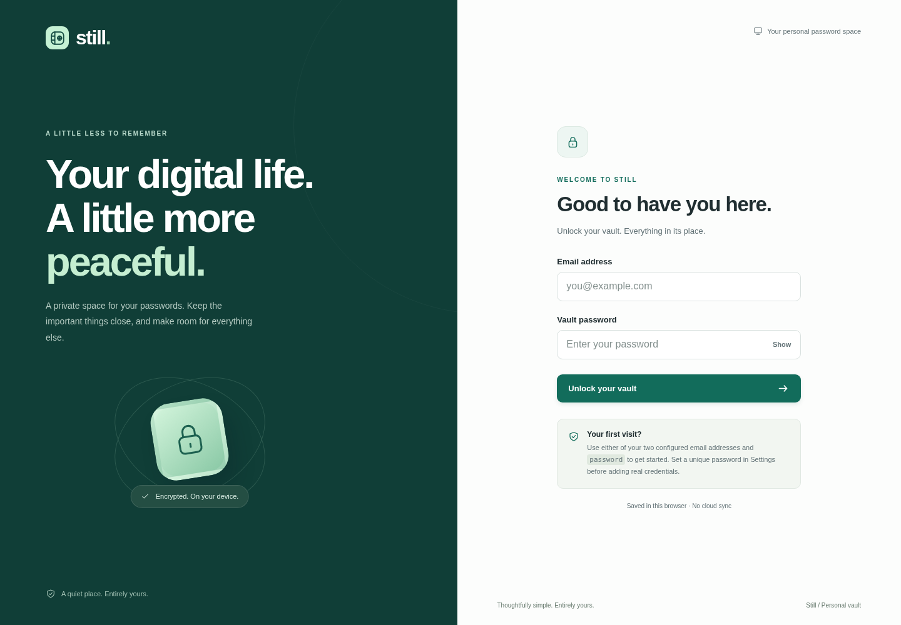
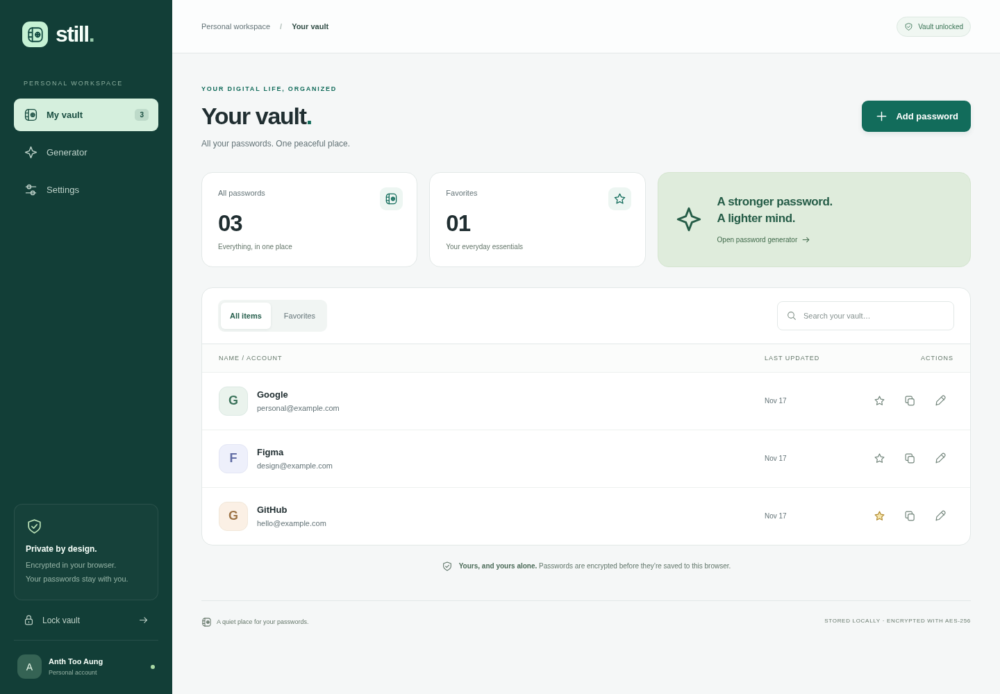
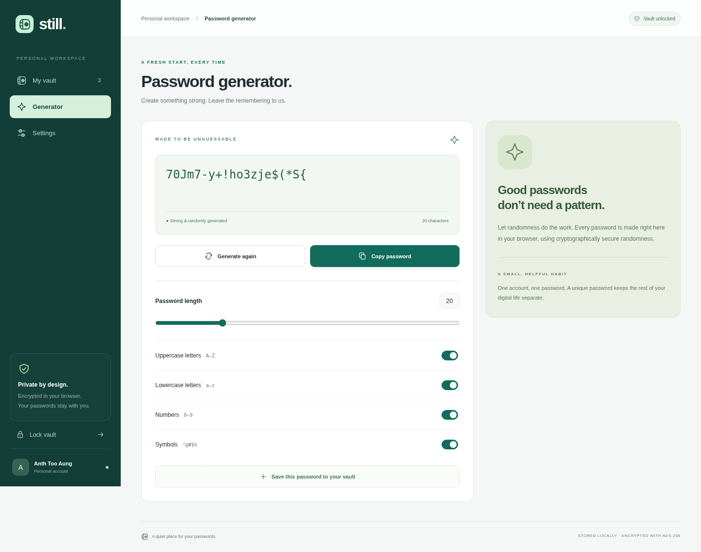
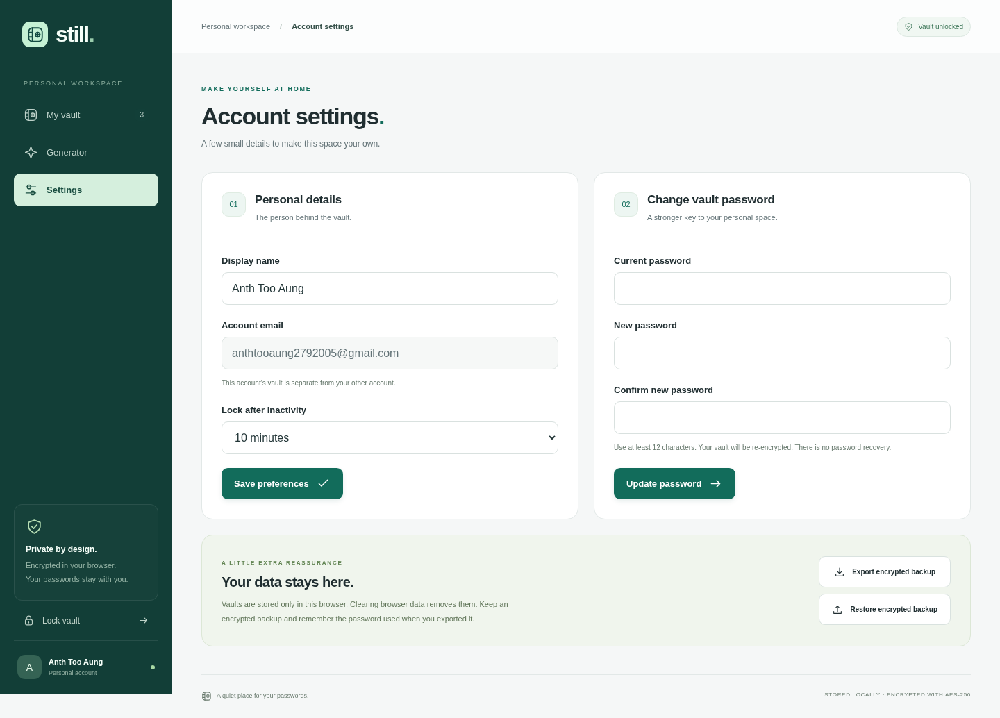
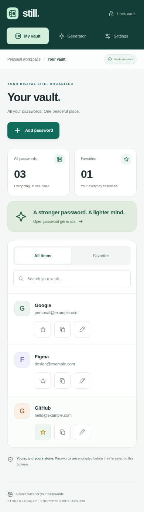

# Still interface preview

Screenshots use illustrative entries created in a disposable browser context. The app starts with an empty vault for a new account.

## Welcome and unlock

## Password vault

## Password generator

## Account settings

## Phone layout

## Validation

- Production builds for the root URL and the GitHub Pages repository prefix succeed.
- Six Playwright tests pass with system Chromium, including encrypted storage, account isolation, password changes, backup restore, generator options, keyboard interactions, and responsive layouts.
- Populated vaults with long names, 64-character generated passwords, and dialogs fit widths from 320 to 1920 pixels.
- A local preview of the GitHub Pages production build loads the login, vault, generator, settings, and favicon without HTTP or browser runtime errors.
